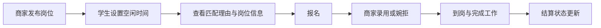

# 周末搭子 · 大学生周末兼职撮合

> 让学生更快找到时间合适、离学校近、报酬透明的周末兼职，也让周边商家更轻松地发布短期用工需求。

**在线体验：** https://uuu-7.github.io/weekend-campus-jobs/

这是一个面向大学生和校园周边商家的双边撮合产品雏形。当前版本重点展示产品结构和关键交互，适合在桌面和手机浏览器中体验。页面视觉采用明亮的黄色、暖色背景和卡片布局，参考了美团相关产品清晰呈现服务信息的方式；本项目是独立的概念作品，并非美团官方产品。

## 1. 为什么做这个产品

大学生希望在周末赚取生活费，但兼职信息常散落在群聊、海报和不同平台中。学生需要反复确认工作时间、通勤距离、具体内容和报酬；商家则经常需要在短时间内找到能按时到岗的人。

「周末搭子」聚焦一个具体场景：**本周末，学校附近有哪些值得报名的短期岗位？**

| 用户 | 关键问题 | 产品回应 |
| --- | --- | --- |
| 学生 | 不知道哪些岗位适合自己的周末时间 | 设置周末空闲时段，按匹配程度排序，并解释匹配理由 |
| 学生 | 担心距离远、报酬和工作内容不清楚 | 展示距离、时薪、预计收入、地点、结算时间和费用说明 |
| 学生 | 报名后不清楚进展 | 「我的报名」展示从报名、录用到结算的状态时间线 |
| 商家 | 短期缺人，难以管理报名与到岗 | 发布岗位、处理申请、关闭岗位并推进到岗和结算状态 |

## 2. 当前版本能做什么

### 学生端

- 浏览示例周末岗位，查看商家、类型、时间、距离和时薪。
- 设置周六、周日各自的可工作时段；系统判断岗位是否完全落在空闲时段内。
- 按日期、类型、关键词筛选，并按匹配程度、薪资或距离排序。匹配程度按**时间适配、示例距离和时薪**计算，是可解释的规则排序。
- 打开岗位详情，查看工作内容、地点、招聘人数、结算时间、费用说明和预计收入。
- 查看「时间符合 / 距离 / 预计收入」三项匹配理由。
- 报名岗位，并在「我的报名」查看「已报名 → 已录用 → 已到岗 → 待结算 → 已结算」时间线；未录用也有单独状态。
- 对重复报名做限制；若岗位超出设定空闲时段，或与其他有效报名的工作时间重叠，则阻止报名并给出提示。
- 在详情页提交岗位举报；举报原因和说明会保存在当前浏览器，便于演示流程。
- 建立体验档案：选择江南大学蠡湖校区或霞客湾校区、兴趣技能和期望最低时薪。推荐排序会增加技能偏好和时薪适配权重。
- 查看商家星级、同学评价与「同学推荐 / 强度提醒」标签；完成工作后可为商家打 1–5 分，选择工作强度、描述相符、结算体验等标签并填写评论。
- 自愿用昵称加入「兼职同学榜」。自己的榜单收入按已结算岗位的时薪 × 工作时长估算；榜上的其他同学是虚构示例。未选择上榜时不会展示自己的昵称。
- 录用后发起到岗确认请求，商家确认后更新报名进度；查看本机录用、到岗、结算等提醒。
- 导出 JSON 体验档案，并在另一台设备手动导入。导入会覆盖目标浏览器的体验记录；这不是实时同步或真实账号登录。

### 商家端

- 填写岗位名称、商家、日期、起止时间、时薪、人数、地点、类型、结算时间与工作说明，并确认不向报名者收费。
- 在商家工作台查看岗位和报名，录用或婉拒申请，依次标记到岗、完成工作、已结算。
- 手动关闭或重新开放未招满的岗位；录用人数达到招聘人数时自动停止报名。
- 发布后可在学生端岗位列表中看到新岗位。
- 在平台审核台演示资料声明登记与举报查看；流程状态仅保存在本机，不构成真实审核。
- 完成工作后登记演示结算金额和凭证编号，学生端可查看记录；不涉及真实支付。

### 页面体验

- 适配桌面和手机屏幕，手机端提供底部导航。
- 使用原生表单校验、键盘可打开的岗位卡片和可关闭的详情弹窗。
- 根据访问日期显示下一次周六、周日的日期标签。
- 在岗位详情中展示商家资料提示、约定结算时间、无收费规则和举报入口。**示例商家未经过真实资质核验**，页面会明确标注演示性质。
- 以江南大学为场景，可切换校区；岗位地点和列表距离仍为示例数据。详情页可打开高德地图搜索工作地点，以核实实际通勤路线。

## 3. 建议的体验路线

1. 打开[在线网页](https://uuu-7.github.io/weekend-campus-jobs/)，在「找兼职」设置周六、周日空闲时间。
2. 查看岗位卡片上的匹配理由，选择时间适合的岗位，阅读结算与安全信息并报名。
3. 切换到「商家招人」，在工作台找到该报名并点击「录用」。
4. 返回「我的报名」发起到岗确认；在商家工作台确认到岗、完成工作并登记结算凭证。
5. 完成后为商家打分，观察岗位卡片上的评价变化；自愿填写昵称加入兼职同学榜，查看自己的估算收入。
6. 填写商家发布表单，发布新岗位；体验审核台、举报入口，以及档案导出和导入。



## 4. 技术实现

项目采用无需构建的静态前端，便于快速部署和持续迭代。

| 文件 | 作用 |
| --- | --- |
| `index.html` | 页面结构、学生端与商家端视图、表单和详情弹窗 |
| `style.css` | 品牌视觉、卡片、弹窗及响应式布局 |
| `enhancements.css` | 空闲时间、商家工作台、状态时间线和安全信息的样式 |
| `app.js` | 示例岗位、匹配规则、时间冲突检查、状态流转、举报和本地数据保存 |
| `phase3.css` | 体验档案、排行榜、评价、审核台和凭证的样式 |
| `phase3.js` | 偏好匹配、档案迁移、榜单、评分、签到、提醒、审核演示及凭证交互 |

岗位列表提供 12 条**虚构示例数据**，以江南大学蠡湖校区周边为演示场景。用户发布的岗位、报名、空闲时间、岗位状态、举报、档案、评价、凭证、提醒和审核演示状态都保存在当前浏览器的 `localStorage`。页面会对用户填写后展示的文本进行 HTML 转义。旧版报名记录在读取时默认按「待商家确认」处理。档案导出文件包含这些演示记录，请自行保管，不要在页面中填写敏感个人信息。

### 本地运行

克隆仓库后，可以直接打开根目录的 `index.html`。也可以在项目根目录运行一个静态服务器，例如：

```bash
python -m http.server 8000
```

然后访问 `http://localhost:8000/`。项目不需要安装前端依赖，也不需要构建命令。页面使用 Google Fonts；字体服务无法访问时会回退到系统字体。

### 在线部署

当前网站通过 **GitHub Pages** 从仓库 `main` 分支的根目录发布：

```text
https://uuu-7.github.io/weekend-campus-jobs/
```

后续更新页面文件并推送到同一个仓库，GitHub Pages 会重新发布，访问地址保持不变。请保留仓库名 `weekend-campus-jobs` 和 Pages 设置，以确保已有链接可继续访问。

## 5. 演示边界

这是用于展示产品思路与交互的**前端雏形**，并非已经接入真实商家和学生的招聘平台：

- 不同浏览器之间**不会实时共享**数据；仅可通过手动导出、导入迁移体验记录。同一浏览器中可以切换学生和商家视角完成流程演示，没有真实账号体系。
- 商家工作台可管理本浏览器内的所有岗位；资料声明、举报处理、签到确认和结算凭证均为演示，没有真实商家核验、人工审核、后台通知或支付服务。
- 匹配程度是基于时间、示例距离、时薪和兴趣技能的规则排序，不是机器学习模型。时间冲突检查覆盖同一天的区间重叠。
- 地点和距离是示例信息；高德地图链接只负责搜索地点，需用户自行核对路线。没有接入实时定位、路线距离或后台推送提醒。
- 示例评分和榜单成员完全虚构。本机提交的评价没有跨设备公开传播；排行榜收入是估算值，不是真实收入记录。

因此，网页中的岗位和报酬仅作产品演示，不应作为真实招聘信息使用。

## 6. 下一步迭代方向

1. 接入数据库、学生与商家账号及权限，让报名、评价、举报和榜单在授权范围内安全同步。
2. 建立真实商家资质核验、岗位审核与人工投诉处理，防止虚假岗位和刷分。
3. 接入真实地理编码、路线与通勤时长，并提供用户授权的推送通知及可信到岗签到。
4. 接入课表授权与技能资料，完善匹配；对接真实支付凭证核验和争议处理。

---

**产品关键词：** 周末限定、校园周边、信息透明、报名有反馈。

